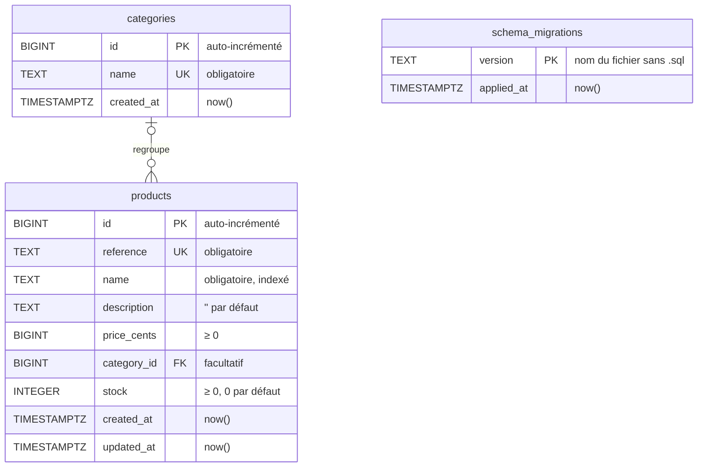

# Schéma de la base de données

Base PostgreSQL 16. Le schéma est créé par les migrations SQL de
[`internal/database/migrations/`](../internal/database/migrations/), appliquées
automatiquement au démarrage de l'application, dans l'ordre de leur nom.

| Migration | Contenu |
|---|---|
| [`0001_init.sql`](../internal/database/migrations/0001_init.sql) | tables `categories` et `products` |
## Diagramme



Une catégorie regroupe zéro, un ou plusieurs produits ; un produit appartient à
zéro ou une catégorie.

## Tables

### `products`

Les produits du catalogue.

| Colonne | Type | Null | Défaut | Description |
|---|---|---|---|---|
| `id` | `BIGINT` | non | identité (auto) | identifiant du produit |
| `reference` | `TEXT` | non | — | référence métier, unique |
| `name` | `TEXT` | non | — | nom du produit |
| `description` | `TEXT` | non | `''` | description libre |
| `price_cents` | `BIGINT` | non | — | prix en centimes (4999 = 49,99) |
| `category_id` | `BIGINT` | **oui** | `NULL` | catégorie du produit, → `categories.id` |
| `stock` | `INTEGER` | non | `0` | quantité disponible |
| `created_at` | `TIMESTAMPTZ` | non | `now()` | date de création |
| `updated_at` | `TIMESTAMPTZ` | non | `now()` | date de dernière modification |

| Contrainte / index | Type | Rôle |
|---|---|---|
| `products_pkey` | clé primaire | sur `id` |
| `products_reference_key` | unique | deux produits ne peuvent pas avoir la même référence |
| `products_price_cents_check` | `CHECK (price_cents >= 0)` | pas de prix négatif |
| `products_stock_check` | `CHECK (stock >= 0)` | pas de stock négatif |
| `products_category_id_fkey` | clé étrangère → `categories(id)` `ON DELETE SET NULL` | voir ci-dessous |
| `products_name_idx` | index | tri et recherche par nom |
| `products_category_id_idx` | index | liste des produits d'une catégorie |

### `categories`

Les catégories de produits.

| Colonne | Type | Null | Défaut | Description |
|---|---|---|---|---|
| `id` | `BIGINT` | non | identité (auto) | identifiant de la catégorie |
| `name` | `TEXT` | non | — | nom, unique |
| `created_at` | `TIMESTAMPTZ` | non | `now()` | date de création |

| Contrainte / index | Type | Rôle |
|---|---|---|
| `categories_pkey` | clé primaire | sur `id` |
| `categories_name_key` | unique | deux catégories ne peuvent pas avoir le même nom |

### `schema_migrations`

Table technique tenue par l'application : une ligne par migration appliquée.
Ne pas la modifier à la main.

| Colonne | Type | Null | Défaut | Description |
|---|---|---|---|---|
| `version` | `TEXT` | non | — | nom du fichier de migration sans `.sql`, clé primaire |
| `applied_at` | `TIMESTAMPTZ` | non | `now()` | date d'application |

## Règles métier portées par la base

Ces règles sont garanties par PostgreSQL lui-même, quelle que soit la façon
dont on écrit dans la base (API, `psql`, script…).

- **Référence unique** : créer ou modifier un produit avec une référence déjà
  prise échoue. L'API répond `409`.
- **Nom de catégorie unique** : même comportement, `409`.
- **Prix et stock jamais négatifs** : toute écriture qui rendrait `price_cents`
  ou `stock` négatif est refusée. Le retrait de stock (`POST /products/{id}/stock`)
  est fait en une seule requête `UPDATE … SET stock = stock + delta`, donc deux
  retraits simultanés ne peuvent pas faire passer le stock sous zéro. L'API
  répond `409 insufficient stock`.
- **Catégorie existante** : un produit ne peut pointer que vers une catégorie
  qui existe. L'API répond `422`.
- **Suppression d'une catégorie** : ses produits sont conservés et leur
  `category_id` passe à `NULL` (`ON DELETE SET NULL`).

Correspondance avec le code Go : ces erreurs PostgreSQL sont converties en
`ErrDuplicateReference`, `ErrDuplicateCategory`, `ErrInsufficientStock` et
`ErrCategoryNotFound` dans [`internal/catalogue`](../internal/catalogue/), à
partir du nom de la contrainte en cause.

## Faire évoluer le schéma

1. Ajouter un fichier numéroté à la suite dans `internal/database/migrations/`,
   par exemple `0002_add_image_url.sql`.
2. **Ne jamais modifier un fichier déjà appliqué** : la base ne le rejouerait
   pas, et les environnements divergeraient.
3. Chaque fichier est exécuté dans une transaction : en cas d'erreur, rien
   n'est appliqué et l'application ne démarre pas.
4. Mettre à jour ce document. Si une contrainte est renommée ou ajoutée,
   vérifier la conversion des erreurs dans `internal/catalogue/product.go`.

## Consulter le schéma d'une base

```sh
psql "$DATABASE_URL" -c '\d products' -c '\d categories'
psql "$DATABASE_URL" -c 'SELECT * FROM schema_migrations ORDER BY version'
```
